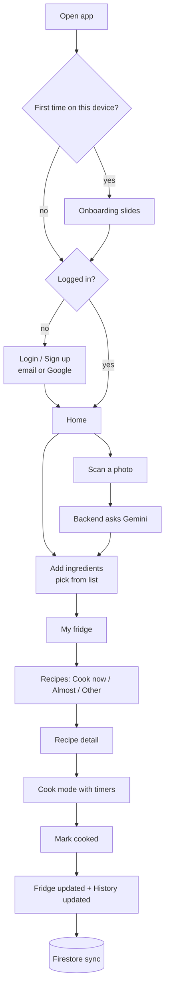

<div align="center">


# Waste2Taste

**Turn what's in your fridge into dinner, and waste less food.**

[Live demo](https://waste2taste-372f4.web.app) · [Backend API](backend/README.md)

</div>

Waste2Taste is a mobile-first Flutter app. You tell it what you have in the fridge (by picking from a list or by taking a photo), and it shows which recipes you can cook right now, which ones are only one or two ingredients away, and which ingredients are about to spoil so you cook those first. When you cook a recipe, the app takes the used ingredients out of the fridge and keeps a history of how many ingredients you saved from the bin.

It runs as a web app and can be installed on a phone like a native app (PWA).

<!--
Screenshots: add images to docs/screenshots/ and show them here, for example:
<p align="center">
  
  
  
</p>
-->

## Features

**Fridge**
- Add ingredients from a built-in list or from a searchable online list of 500+ ingredients (with photos).
- Scan a photo of your fridge or groceries. The ingredients are recognised by Gemini and matched to the ingredient list.
- Items that spoil first are shown on top. Each ingredient has a rough shelf life, and pantry items (rice, salt, sauces) never expire.
- The fridge starts empty on first launch and only keeps what you add, minus what you cook.

**Recipes**
- Three tabs: **Cook now** (you have everything), **Almost** (missing one or two things), **Other recipes** (ideas from TheMealDB that use your ingredients).
- Filters for **My kitchen tools** (stove, rice cooker, microwave, oven, air fryer, blender, steamer, toaster) and **Under 20 min**.
- A random **Cook tonight** suggestion on the home screen, with a Shuffle button.
- Recipe detail with what you have and what is missing, then a step-by-step **cook mode** with a countdown timer on timed steps.
- **Mark cooked** removes the used ingredients from the fridge and adds the recipe to your history.

**Food waste tracking**
- History shows meals cooked and how many ingredients you saved from the bin (ingredients that were about to expire when you used them).
- Optional **expiry reminders**: one notification at 09:00 the day before an ingredient goes bad (phone app only).

**Accounts and sync**
- Email and password sign-up, Google sign-in, password reset.
- Your fridge, history and settings follow your account through Firestore, so they are the same on every device.
- Food preferences (Halal, Vegetarian) filter the recipes.

**App experience**
- Installable PWA with its own icon and name, full-screen with no browser bar.
- Animated onboarding, sticky recipe tabs, loading and error states for every network call.

## How it works



## Tech stack

| Layer | What is used |
|---|---|
| App | Flutter (Dart 3), Material 3, `provider` for state |
| Local storage | `shared_preferences` |
| Accounts | Firebase Authentication (email/password, Google) |
| Cloud data | Cloud Firestore (one document per user) |
| Notifications | `flutter_local_notifications`, `timezone` |
| Camera / gallery | `image_picker`, `image` (photo is shrunk before upload) |
| Backend | Vercel serverless functions (Node.js, ES modules) |
| AI | Google Gemini (photo to ingredient list), with model fallback |
| Recipe and ingredient data | [TheMealDB](https://www.themealdb.com/api.php) |
| Hosting | Firebase Hosting (web app / PWA), Vercel (API) |
| Fonts | Plus Jakarta Sans via `google_fonts` |

## Architecture

```
Flutter app (web / PWA)
   |-- AppState (provider) ---- shared_preferences      local copy, works offline
   |        |
   |        '---- Cloud (Firestore users/{uid}) ------ synced per account
   |-- Auth (Firebase Authentication)
   '-- Api (http) ----> Vercel functions ----> TheMealDB
                              |
                              '--------------> Gemini API
```

- **`AppState`** is the single source of truth: fridge, history, preferences, kitchen tools and the account name. Screens read it with `context.watch` and change it through its methods. Every change is saved locally right away and pushed to Firestore a second later.
- **The Gemini key never reaches the app.** The app sends the photo to `/api/scan`, and only the server holds the key.
- **Ingredients from the online list** are registered into the app's catalog at runtime and saved with the account, so they still have a name and a photo on the next launch.

## Backend API

The functions live in [`backend/api`](backend/api). See [`backend/README.md`](backend/README.md).

| Endpoint | What it does |
|---|---|
| `GET /api/ingredients?q=&limit=` | Search the 500+ ingredient list from TheMealDB (cached for 24 hours) |
| `GET /api/recipes?ingredients=egg,rice` | Recipes that use the most of your ingredients |
| `POST /api/scan` | Photo (base64) to a list of ingredients using Gemini |

Safeguards: the scan endpoint accepts only JPEG, PNG, WebP and HEIC up to a size limit, is rate limited per IP (10 scans per 10 minutes), and tries several Gemini models in turn with a time limit on each, so a busy or retired model does not break scanning.

## Data and security

Each account has one Firestore document at `users/{uid}` with the fridge, history, diet, tools, reminder setting and custom ingredients. The rules in [`firestore.rules`](firestore.rules) let a signed-in user read and write only their own document.

On logout the data on the device is cleared (it stays in the cloud), so the next person to log in on the same device never sees it.

## Project structure

```
lib/
  main.dart                 app entry, picks onboarding / login / home
  theme.dart                colours, fonts, spacing
  data/                     models and the built-in ingredients and recipes
  state/app_state.dart      app state, local save, cloud sync, recipe matching
  services/                 api, auth, cloud (Firestore), notifications, photo
  screens/                  home, recipes, cook mode, scan, history, profile, login ...
  widgets/common.dart       shared widgets (cards, sheet layout, ingredient image)
backend/api/                serverless functions (ingredients, recipes, scan)
web/                        PWA manifest, icons, index.html
firestore.rules             Firestore security rules
firebase.json               Firebase Hosting and Firestore config
```

## Getting started

Requirements: Flutter (Dart 3.13 or newer), Node.js 18+, a Firebase project and a Gemini API key.

```bash
git clone https://github.com/vaniallic/Waste2Taste.git
cd Waste2Taste
flutter pub get
flutter run -d chrome
```

**Firebase** (login and sync). Without it the app still runs and falls back to a simple local login.

```bash
dart pub global activate flutterfire_cli
npm install -g firebase-tools
firebase login
flutterfire configure --project=<your-project-id> --platforms=web
```

In the Firebase console turn on **Email/Password** and **Google** under Authentication, create a Firestore database, and publish the rules from `firestore.rules`.

**Backend.** Deploy the `backend` folder to Vercel and set `GEMINI_API_KEY` (optionally `GEMINI_MODELS`, a comma-separated list of model names). Then point `apiBase` in `lib/services/api.dart` to your deployment.

## Deploy

```bash
flutter build web --release
firebase deploy --only hosting --project <your-project-id>
```

The API deploys by itself every time the `main` branch changes (Vercel is connected to the repository). To install the web app on a phone, open it in Safari (iPhone) and choose Add to Home Screen, or in Chrome (Android) and choose Install app.

## Known limitations and ideas

- The web app and PWA are the tested targets. The Android and iOS folders contain the setup for local notifications, but the native builds have not been tested on a device.
- Expiry reminders work only in the phone app, not in the browser.
- Apple sign-in is not implemented yet. The Language setting is a placeholder.
- Only the **Halal** and **Vegetarian** preferences filter the recipes. The other chips are saved but not used yet.
- Recipes from "Other recipes" can be read but not cooked step by step.
- Cloud data is loaded when the app opens or you log in, not live, so editing on two devices at the same time can overwrite changes.
- The rate limiter is kept in memory per server instance, so it is a best-effort protection.
- No automated tests yet.

## Credits

Recipe and ingredient data and photos from [TheMealDB](https://www.themealdb.com/). Ingredient recognition by Google Gemini. Built by Vania Alicia Yocelin ([@vaniallic](https://github.com/vaniallic)).
